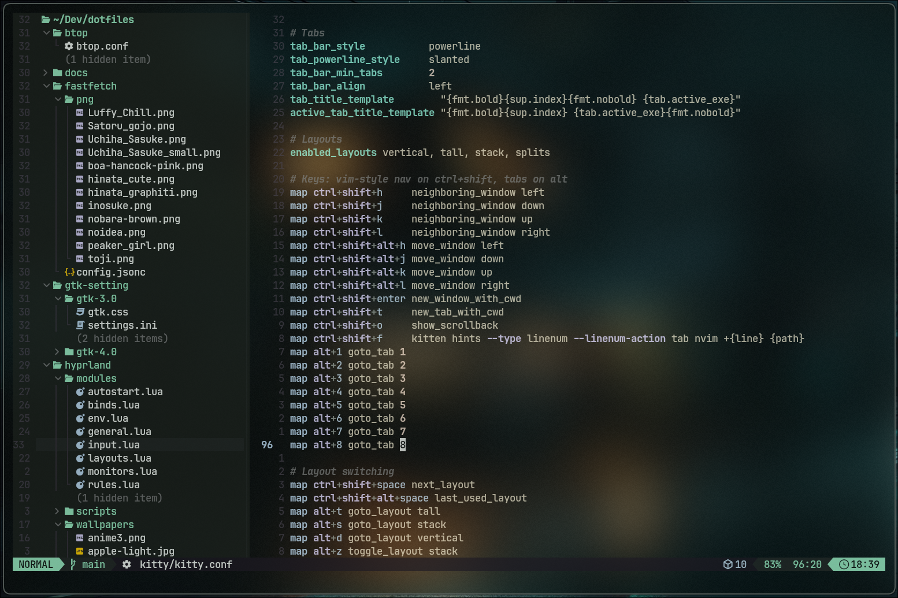
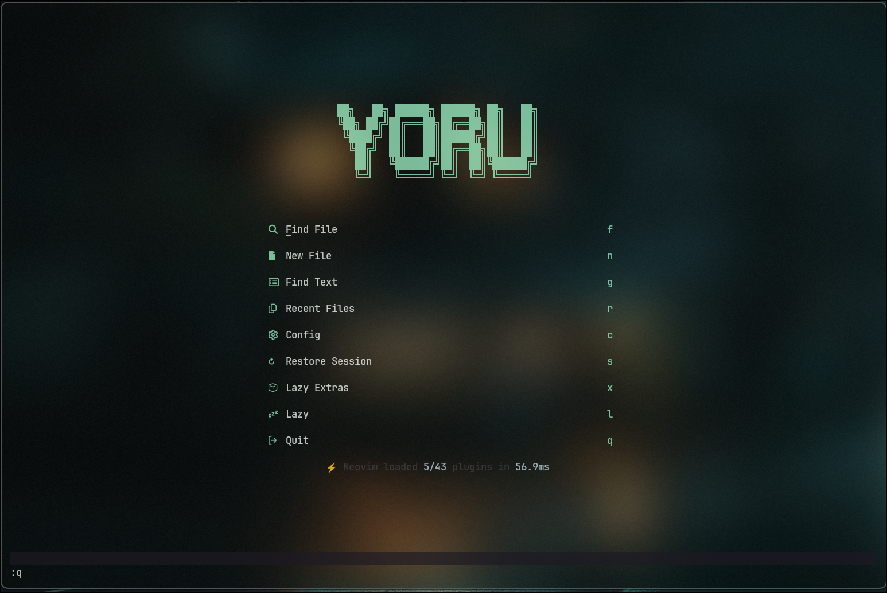
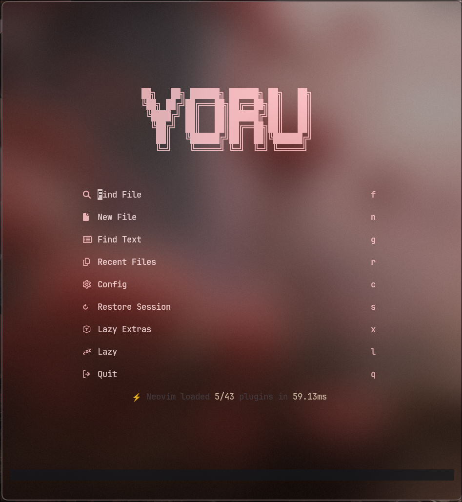
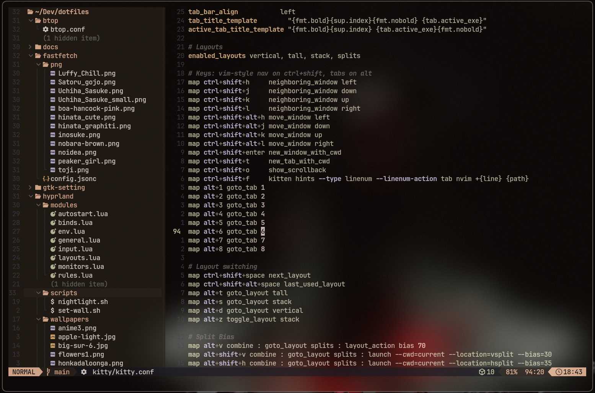
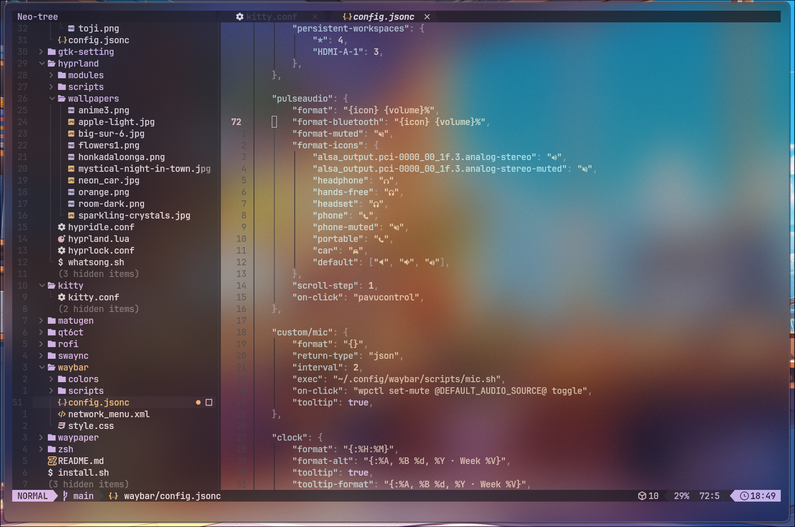

# Yoru Neovim

License: [Apache-2.0](LICENSE). Base: [LazyVim](https://github.com/LazyVim/LazyVim).

## Overview

Yoru is a LazyVim-based Neovim configuration for TypeScript development, dotfiles, and writing, managed with `lazy.nvim`. It keeps the native bottom command line and follows the desktop palette through Matugen, with transparent editor backgrounds.

Neovim leaves editor backgrounds transparent, **Kitty controls opacity**, and **Hyprland controls blur**. The desktop setup owns readability adjustments; this configuration does not change terminal opacity or compositor settings.

For inherited behavior and mappings, use the [LazyVim docs](https://www.lazyvim.org/).

## Screenshots

Mint editor with the desktop wallpaper visible through Kitty:



| Mint dashboard                                                                    | Pink dashboard                                                                    |
| --------------------------------------------------------------------------------- | --------------------------------------------------------------------------------- |
|  |  |

| Peach editor                                                 | Purple editor and buffer tabs                                                                      |
| ------------------------------------------------------------ | -------------------------------------------------------------------------------------------------- |
|  |  |

The screenshots include the surrounding Kitty/Hyprland setup; Neovim alone does not provide the opacity or blur shown here.

## Prerequisites

- Neovim **0.12+** built with LuaJIT; verified on **0.12.6**. Older versions are not validated with this lockfile.
- Git **2.19+** for partial clones, plus network access for the initial plugin/tool installation.
- A C compiler, `tar`, `curl`, and Tree-sitter CLI **0.26.1+** for parser builds. Install the CLI through a system package manager, not npm.
- `ripgrep`, `fd`, and `fzf` for search and picker workflows.
- Node.js/npm for Prettier, ESLint tooling, and Vtsls.
- A Python 3 environment for Python tools and tests; install project test runners separately.
- A Nerd Font for icons and a clipboard provider for the system clipboard, such as `wl-clipboard` on Wayland.
- Optional: Matugen writing `~/.config/matugen/themes/nvim-colors.json`.
- Optional: Kitty and Hyprland for the desktop transparency/blur presentation shown above.

## Installation

### Try without replacing your existing setup

```bash
git clone https://github.com/ae-orlando/YoruNeovim.git "${XDG_CONFIG_HOME:-$HOME/.config}/yoru"
NVIM_APPNAME=yoru nvim
```

`NVIM_APPNAME=yoru` keeps Neovim's configuration, plugin data, state, and cache separate from the default `nvim` directories. Keep using that prefix when launching this installation. The Matugen palette path is shared with the desktop, not isolated by the application name.

### Use as your default

Move any existing Neovim configuration to a backup location first. Then clone into the default location; Git refuses to clone over a nonempty configuration directory:

```bash
git clone https://github.com/ae-orlando/YoruNeovim.git "${XDG_CONFIG_HOME:-$HOME/.config}/nvim"
nvim
```

On first run, `lua/config/lazy.lua` bootstraps `lazy.nvim`. Allow plugin and tool installation to finish, then inspect `:Lazy`, `:Mason`, and `:checkhealth`. Existing Mason tools and plugins in a default installation may affect the result; use the isolated installation for a clean trial.

## Usage

Start with `NVIM_APPNAME=yoru nvim`, or `nvim` for a default installation. The leader key is Space. `lua/config/keymaps.lua` is empty; Yoru-specific mappings live in plugin specs.

### Yoru mappings

| Keys         | Action                                     | Source                           |
| ------------ | ------------------------------------------ | -------------------------------- |
| `<leader>fp` | Format buffer or visual selection          | `lua/plugins/formatting.lua:77`  |
| `<leader>fl` | Lint the current file                      | `lua/plugins/formatting.lua:106` |
| `<leader>pp` | Open the Snacks project picker             | `lua/plugins/project.lua:7`      |
| `<leader>Ss` | Save the current project session           | `lua/plugins/session.lua:8`      |
| `<leader>Sl` | Restore the current project/branch session | `lua/plugins/session.lua:15`     |
| `<leader>Sd` | Stop automatic session saving for this run | `lua/plugins/session.lua:22`     |
| `<leader>mp` | Start browser preview                      | `lua/plugins/live-server.lua:16` |
| `<leader>mx` | Stop browser preview                       | `lua/plugins/live-server.lua:17` |
| `<leader>mf` | Pick a file to preview                     | `lua/plugins/live-server.lua:18` |
| `<leader>tr` | Run the nearest test                       | `lua/plugins/test.lua:26`        |
| `<leader>tf` | Run tests in the current file              | `lua/plugins/test.lua:33`        |
| `<leader>ta` | Run tests from the working directory       | `lua/plugins/test.lua:40`        |
| `<leader>ts` | Toggle the test summary                    | `lua/plugins/test.lua:47`        |
| `<leader>to` | Open test output                           | `lua/plugins/test.lua:54`        |

TODO search (`<leader>st` / `<leader>sT`), TODO navigation, and Trouble mappings follow LazyVim and the selected picker. Telescope is not required.

Persistence automatically saves session layout and open-file information on exit. Restoration is explicit; `<leader>Sl` restores the current project/branch, while LazyVim's `<leader>ql` restores the most recently saved session. Session files live under `stdpath("state")/sessions/` and do not replace recovery of unsaved edits.

Browser preview supports HTML, Markdown, AsciiDoc, and SVG on `127.0.0.1:5500` (`lua/plugins/live-server.lua:3`).

Debugging mappings come from LazyVim's `dap.core` and `test.core` extras (`lazyvim.json:3`, `lazyvim.json:13`): `<leader>db` toggle breakpoint, `<leader>dc` continue, `<leader>di` / `<leader>do` step in/out, `<leader>du` debugger UI, and `<leader>td` debug the nearest test. Node/browser debugging is wired through the TypeScript extra; Python debugging uses `debugpy`; C/C++ debugging uses `codelldb` from the clangd extra (`lazyvim.json:4`). `<leader>D` toggles the Dadbod database UI from the SQL extra (`lazyvim.json:8`); connections are configured per project through `vim.g.dbs` and are never stored in this repository.

### Language tooling

| Language                            | Configured tooling                                                                                            |
| ----------------------------------- | ------------------------------------------------------------------------------------------------------------- |
| JavaScript / TypeScript / JSX / TSX | Vtsls, Prettier, ESLint LSP diagnostics (save-time auto-fix disabled), Vitest adapter, Node/browser debugging |
| HTML / CSS / Tailwind               | html and cssls servers, Tailwind CSS server, Prettier                                                         |
| Python                              | Pyright, Isort then Black, Pylint, virtualenv selector, pytest adapter, debugpy; Ruff LSP disabled            |
| C / C++ / CUDA                      | clangd with clang-tidy diagnostics, clang-format, codelldb debugging, `<leader>ch` source/header switch       |
| JSON / YAML / JSONC / JSON5         | jsonls and yamlls with SchemaStore validation (jsonls never formats), Prettier without trailing commas        |
| Docker / Compose                    | Dockerfile and Compose language servers, Hadolint                                                             |
| SQL                                 | Dadbod database UI and completion, SQLFluff using the project dialect                                         |
| Markdown                            | Prettier, Markdownlint, in-editor rendering, browser preview                                                  |
| Shell                               | bash-lsp hover/completion, Shfmt formatting, ShellCheck diagnostics                                           |
| Lua                                 | LazyVim's Lua language server, StyLua, Plenary test adapter                                                   |

Sources: `lazyvim.json:2`, `lua/plugins/formatting.lua:6`, `lua/plugins/mason.lua:9`, `lua/plugins/lsp.lua:53`, and `lua/plugins/test.lua:17`. Project test runners such as pytest and Vitest must be installed in the project's environment. Installing a Mason tool does not by itself configure every editor integration for it.

## Configuration

### Native interface and editing defaults

- Keep native `:`, `/`, and `?` at the bottom. Noice handles notifications, not command lines, messages, or LSP hover/signature windows (`lua/plugins/noice.lua:5`).
- Highlight the current line number rather than the full line, and keep comments bold (`lua/config/options.lua:17`, `lua/config/autocmds.lua:28`).
- Use four-space editor defaults. Prettier and Shfmt receive explicit four-space arguments; **Prettier's arguments override project indentation settings**. StyLua and clang-format follow the target project's configuration; this repository's `stylua.toml` specifies four spaces (`lua/plugins/formatting.lua:44`).
- Keep Gitsigns disabled (`lua/plugins/git.lua:5`).
- Linting is manual-only (`<leader>fl`); automatic lint autocmds are disabled to avoid noisy false positives. Low-severity hint/info diagnostics are also hidden.
- Nothing rewrites a file unless asked: format-on-save is off (`vim.g.autoformat = false`, `lua/config/options.lua:7`), ESLint's save-time auto-fix is off (`vim.g.lazyvim_eslint_auto_format = false`, `init.lua:12`), and jsonls is validation-only (`lua/plugins/lsp.lua:87`). Format explicitly with `<leader>fp` or LazyVim's `<leader>cf`; `<leader>uf` re-enables auto-format for a session.
- JSON never gains trailing commas: `json`, `jsonc`, and `json5` use a dedicated `prettier_json` formatter with `--trailing-comma none`, so jsonls validation has nothing to flag (`lua/plugins/formatting.lua:49`).
- Inlay hints stay off globally to keep buffers clean; hover and signature help remain on demand (`lua/plugins/lsp.lua:50`).

### System theme and transparency

If the palette file is readable at startup, Yoru uses `daedlock/matugen.nvim` with watching enabled. Otherwise it uses transparent Catppuccin Mocha. Palette settings live in `lua/plugins/colorscheme.lua`.

`Normal`, `NormalNC`, `SignColumn`, `FoldColumn`, `EndOfBuffer`, and `MsgArea` remain transparent. Floats and panels retain their existing theme backgrounds. Palette reloads refresh lualine and Bufferline colors while preserving their configuration.

Matugen syntax receives bounded, wallpaper-adaptive color-intensity boosts for functions, types, strings, numbers, constants, and properties. Methods share the function tint; keywords, plain variables, comments, and punctuation keep their theme colors. Tune the gains and caps in `lua/config/syntax.lua:6`. The layer preserves existing text styles and LSP highlight links, reapplies on palette reloads, and leaves the shared palette and Catppuccin fallback untouched. The cursor-line number retains its original UI tint (`lua/config/autocmds.lua:5`).

**Do not add editor backgrounds to compensate for wallpaper readability.** Adjust opacity in Kitty and blur in Hyprland; neither is configured by this repository.

### Matugen palette setup

Without a readable palette file, Yoru uses Catppuccin. To enable wallpaper-adaptive colors, create `~/.config/matugen/templates/nvim-colors.json` with flat Material 3 tokens:

```json
{
    "surface_container_lowest": "{{colors.surface_container_lowest.default.hex}}",
    "surface_dim": "{{colors.surface_dim.default.hex}}",
    "surface": "{{colors.surface.default.hex}}",
    "surface_container_low": "{{colors.surface_container_low.default.hex}}",
    "surface_container": "{{colors.surface_container.default.hex}}",
    "surface_container_high": "{{colors.surface_container_high.default.hex}}",
    "surface_container_highest": "{{colors.surface_container_highest.default.hex}}",
    "outline": "{{colors.outline.default.hex}}",
    "outline_variant": "{{colors.outline_variant.default.hex}}",
    "on_surface": "{{colors.on_surface.default.hex}}",
    "on_surface_variant": "{{colors.on_surface_variant.default.hex}}",
    "primary": "{{colors.primary.default.hex}}",
    "secondary": "{{colors.secondary.default.hex}}",
    "tertiary": "{{colors.tertiary.default.hex}}",
    "error": "{{colors.error.default.hex}}"
}
```

Add or update this entry in your existing `~/.config/matugen/config.toml`; do not replace its other templates:

```toml
[templates.nvim]
input_path = "~/.config/matugen/templates/nvim-colors.json"
output_path = "~/.config/matugen/themes/nvim-colors.json"
```

Generate the palette through your normal Matugen wallpaper workflow, then restart Neovim if it started before the file existed. The output must be a flat JSON object of hex strings, not a nested color-scheme export. Missing tokens use the plugin's baseline palette; see [matugen.nvim's palette contract](https://github.com/daedlock/matugen.nvim#the-json).

With Matugen active, use `:MatugenReload` to re-read the palette and `:MatugenWatch off` / `:MatugenWatch on` to control watching. The shared palette path remains `~/.config/matugen/themes/nvim-colors.json`, including when using `NVIM_APPNAME=yoru`.

## Checks

Run the dependency-free regression checks from the repository root:

```bash
nvim --headless -u NONE -i NONE -n -l tests/run.lua
```

To also exercise the real plugins, point `YORU_TEST_PLUGIN_DIR` at an existing installation whose commits match `lazy-lock.json`. For the isolated installation above:

```bash
YORU_TEST_PLUGIN_DIR="${XDG_DATA_HOME:-$HOME/.local/share}/yoru/lazy" \
    nvim --headless -u NONE -i NONE -n -l tests/run.lua
```

For a default installation, use the `nvim/lazy` directory instead. Integration checks do not install plugins, access the network, change the desktop palette, or write session files. They cover palette reloads, syntax-only foreground changes across dark/light palettes, preserved UI options and hook counts, picker mappings, session-stop behavior, Colorizer compatibility, and the fullstack extras and tooling wiring.

## Project Structure

```text
init.lua           # bootstrap
lua/config/        # LazyVim setup, options, syntax colors, highlight autocmds
lua/plugins/       # Yoru overrides and workflow mappings
assets/            # screenshots
tests/run.lua      # isolated regression and opt-in integration checks
lazyvim.json       # enabled LazyVim extras
lazy-lock.json     # plugin commit pins, not Mason/project tool versions
stylua.toml        # Lua formatting for this repository
.prettierrc.json   # Prettier formatting for this repository
.editorconfig      # repository indentation and whitespace
```
