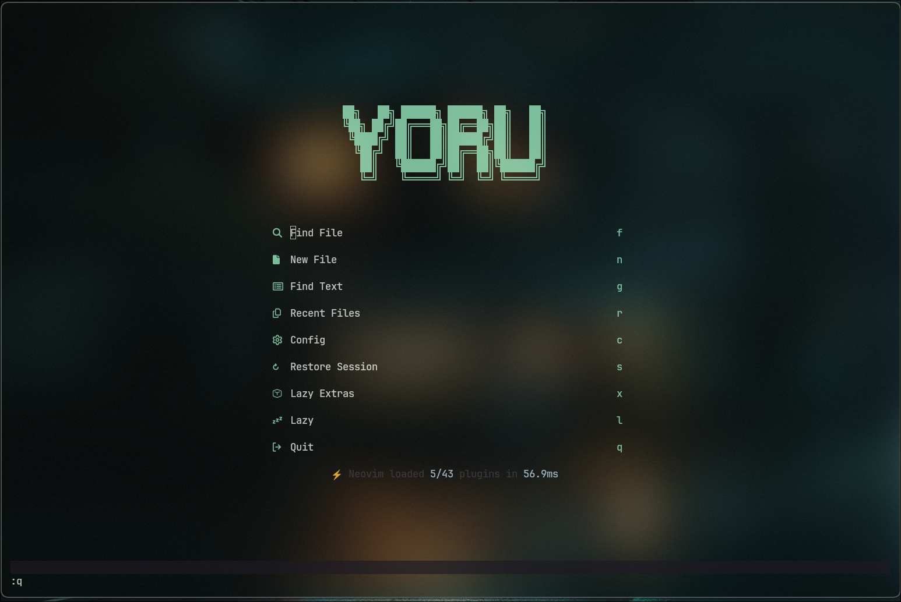
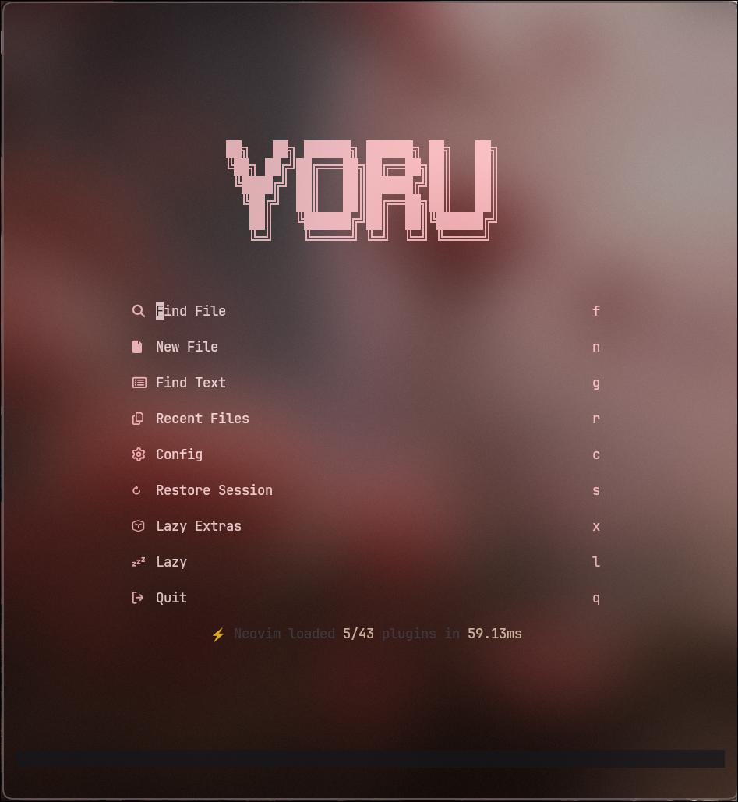
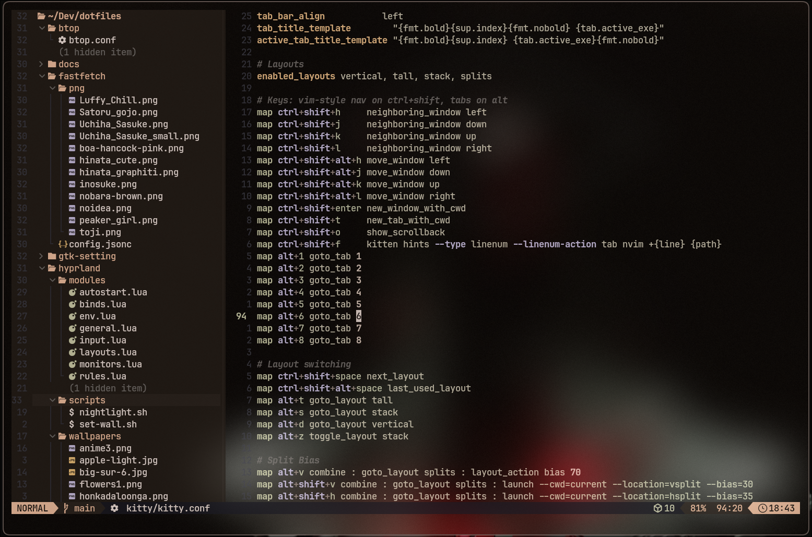
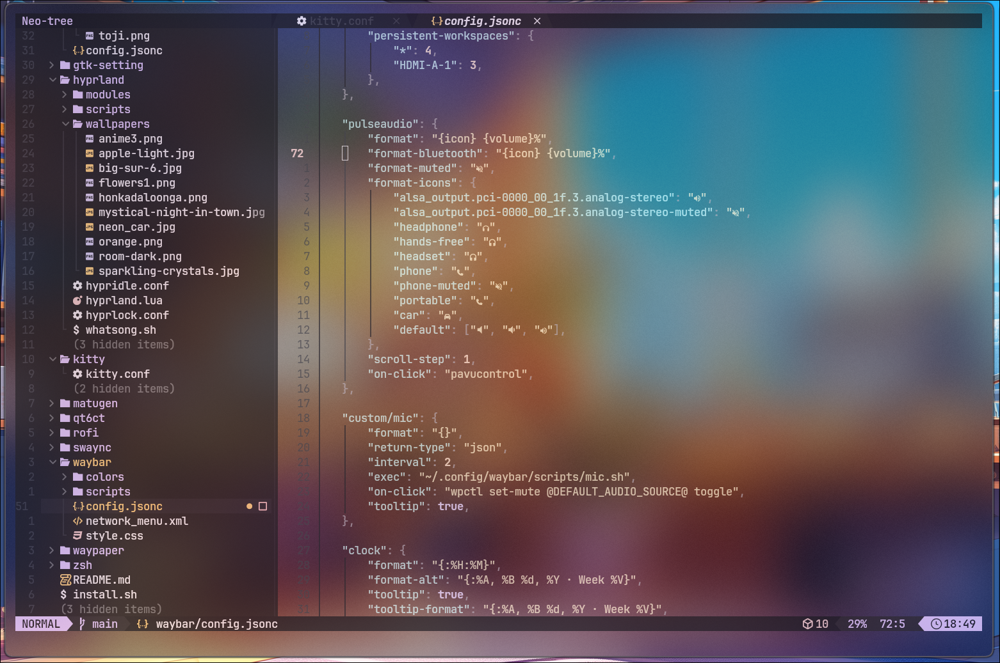

# Yoru Neovim

> [!WARNING]
> This is not a neovim distro It is basically just a themed opinionated config on top of `LazyVim`.
> In fact it is just a neovim configuration tweaked to suit my workflow, language tooling and most importantly **eye candy**
> So if you are just looking for a neovim distro that works and don't want "bloat". Hit the road, dude.
> If you do decide to try `Yoru Neovim`, though. You're gonna love it.

If you just want to read the guide, see the [LazyVim docs](https://www.lazyvim.org/).

## Why Yoru Neovim and not LazyVim

To be honest, I don't really see the reason why anyone else would want to use this config when they can just install the [LazyVim](https://github.com/LazyVim/LazyVim) and have fun setting up the configuration that you like.
However, These are some of the reasons I like it so much:

1. Tinkering is fun

### Dynamic Theming

**`Yoru Neovim`** Folows your system theme. _Sweet, right??_.

> [!IMPORTANT]
> The dynamic theming gets its colors from a file genrated by matugen in my desktop environment [HyprYoru](http://github.com/ae-orlando/HyprYoru). _Go check it out and leave a star its beautiful_.
> If you don't use `HyprYoru` and you're on hyprland. I've put the guide to getting dynamic theming below. <!-- TODO: link -->
> If you are not on `Hyprland` the theme will fallback to **`Cattppucin Mocaha`**
> Feel free to set your desired theme. _Though I don't see why you'd want to apply this config if you are going to set a static theme, to be honest. But suite yourself_

### Core Features

| Feature                    | Keys                                          | Description                                                                                        | Advantage                                                                       |
| :------------------------- | :-------------------------------------------- | :------------------------------------------------------------------------------------------------- | :------------------------------------------------------------------------------ |
| **Notes**                  | `<leader>m` group                             | Capture, journal, concept, evidence, and review notes with auto‑dated markdown templates.          | Quick capture → organized review; templates enforce structure without thinking. |
| **In‑box / Find / Grep**   | `<leader>mi`, `<leader>mf`, `<leader>mg`      | Snacks picker navigation of `00‑inbox`, the vault, or vault‑wide grep.                             | Locate any note in under two seconds.                                           |
| **Obsidian integration**   | `<leader>mo`                                  | Opens the current note via `obsidian://open`.                                                      | Seamless switch between Neovim and Obsidian vault.                              |
| **Task capture**           | `<leader>mT`                                  | Prompts for a task and creates it in taskwarrior.                                                  | Capture ideas from Neovim directly into your task system.                       |
| **Backlinks**              | `<leader>mb`                                  | Attempts LSP‑based reference lookup.                                                               | See where a note is referenced without leaving the buffer.                      |
| **Which‑key help**         | `<leader>m`                                   | Pops a Which‑key menu of note commands.                                                            | Discover note commands without memorising keys.                                 |
| **Terminal / Taskwarrior** | `<leader>mN`                                  | Bottom‑terminal toggles for `task next` or custom commands.                                        | Run task management without leaving Neovim.                                     |
| **LSP / Language tooling** | —                                             | Pre‑configured LSPs for JavaScript/TypeScript, Python, Rust, and more; inlay hints off by default. | Sensible defaults; keep buffers clean, enable help on demand.                   |
| **Formatting / Lint**      | `<leader>fp` format, `<leader>fl` manual lint | Auto‑format off; explicit command for formatting and linting.                                      | No surprise rewrites; explicit control when you need it.                        |
| **Session management**     | `<leader>Sl`                                  | Saves/restores project sessions.                                                                   | Re‑open exactly where you left off after a break.                               |
| **Matugen palette**        | —                                             | Wallpaper‑adaptive colors via `matugen.nvim`; fallback to Catppuccin Mocha.                        | Your wallpaper drives the editor theme, or a reliable default out of the box.   |
| **Markdown reading**       | `zc` / `zo` / `zM` / `zR`                     | Heading bands and fold-on-demand text; folds stay open by default (`foldlevel=99`).                | Readable heading hierarchy; collapsed sections stay identifiable.               |
| **Exercise / solution**    | `<leader>me`, `<leader>ms`                    | Create exercise and solution notes with track and concept prompts.                                 | Structured practice workflow.                                                   |
| **Doc images**             | —                                             | Renders Markdown and Obsidian image embeds in floats with the editor background.                   | Images stay readable without leaving the buffer.                                |

## Prerequisites

- Neovim **0.12+** built with LuaJIT; verified on **0.12.6**.
- **Git** for cloning and partial clones.
- **ripgrep**, **fd**, **fzf** for search and picker workflows.
- A **C compiler**, `tar`, `curl` for plugin installs.
- Node.js/npm for Prettier, ESLint, Vtsls, Emmet.
- Python 3 for Python tools and tests.
- A **Rust toolchain** (`rustc`, `cargo`, `rustfmt`, `clippy`) for Rust builds; Mason installs `rust-analyzer` and Taplo.
- A **Nerd Font** for icons and a clipboard provider (e.g., `wl-clipboard` on Wayland).

Optional: Matugen writing `~/.config/matugen/themes/nvim-colors.json`, Kitty and Hyprland for the transparency/blur presentation shown in screenshots.

## Installation

### Try without replacing your existing setup

```bash
git clone https://github.com/ae-orlando/YoruNeovim.git "${XDG_CONFIG_HOME:-$HOME/.config}/yoru-nvim"
NVIM_APPNAME=yoru nvim
```

`NVIM_APPNAME=yoru` keeps Neovim's configuration, plugin data, state, and cache separate from the default `nvim` directories. Keep using that prefix when launching this installation. The Matugen palette path is shared with the desktop, not isolated by the application name.

### Use as your default

Move any existing Neovim configuration to a backup location first. Then clone into the default location; Git refuses to clone over a non‑empty configuration directory:

```bash
git clone https://github.com/ae-orlando/YoruNeovim.git "${XDG_CONFIG_HOME:-$HOME/.config}/nvim"
nvim
```

On first run, `lua/config/lazy.lua` bootstraps `lazy.nvim`. Allow plugin and tool installation to finish, then inspect `:Lazy`, `:Mason`, and `:checkhealth`. Existing Mason tools and plugins in a default installation may affect the result; use the isolated installation for a clean trial.

## Usage

Start with `NVIM_APPNAME=yoru nvim`, or `nvim` for a default installation. The leader key is **Space**.

## Screenshots

Yoru is designed to work with your desktop environment. The screenshots below show the editor with the desktop wallpaper visible through Kitty, and the various palette themes.

|                                 Mint dashboard                                 |                                 Pink dashboard                                 |
| :----------------------------------------------------------------------------: | :----------------------------------------------------------------------------: |
|  |  |

|                         Peach editor                         |                                   Purple editor and buffer tabs                                    |
| :----------------------------------------------------------: | :------------------------------------------------------------------------------------------------: |
|  |  |

<center>Mint</center>

<center>Pink</center>

<center>Peach</center>

<center>Purple</center>
